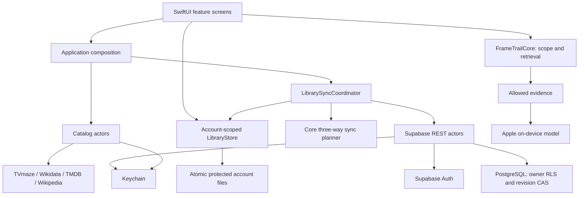

# Architecture

FrameTrail keeps story scope independent of the model. The system selects evidence before inference, and keeps account data independent of network availability.

## Boundaries

The core package accepts values and produces values. It cannot reach the network, inspect account tokens or invoke inference. Providers translate external JSON at their boundaries. A typed HTTP client enforces transport limits and cancellation. The local model receives a bounded evidence packet and cannot autonomously fetch more data.

LibraryStore commits files before publishing changed state. Each FrameTrail account has its own SHA-256-derived path; guest records remain local and separate. Its archive atomically stores the library and acknowledged synchronization baseline. Exports exclude baselines and credentials. Remote projections contain title metadata, progress and reflections only; source texts, episode descriptions and conversations are never in that projection. A remote progress rewind clears the affected discussion while preserving source material.

The pure core planner compares local values, remote records and the previous baseline. One-sided changes synchronize; concurrent divergent changes require explicit resolution. Compare-and-swap RPC writes use server revisions, including deletion tombstones. A private SECURITY DEFINER implementation enforces auth.uid ownership and verified-account existence; its exposed SECURITY INVOKER wrapper grants no direct table mutation rights. Authenticated reads use owner RLS. The account-deletion function verifies the caller through Auth before using server-only administrative credentials to delete that same user.

SupabaseAuthService serializes refreshes and guards credential writes against logout/account-change races. Keychain stores refreshable sessions, never passwords. AppModel activates the authenticated user's offline namespace; TMDB authorization is a separate optional watchlist connection and cannot change that namespace. The bundled project URL and publishable key are public configuration, not privileged credentials.

Views compose domain operations and display current state. They do not implement episode eligibility or deserialize provider payloads. AppModel owns the service instances and account lifecycle. Small native components keep layout consistent without introducing a separate design-system dependency.

## Quality boundaries

Post-viewing reviews have two distinct boundaries. Wikipedia acquisition checks completion before networking; episode acquisition also matches the article name and rendered episode infobox against series/season/episode. It pins that validated revision and reads only its Plot section. A missing or ambiguous match falls back to existing material, never a broader season article. Retrieved paragraphs remain episode-scoped StoryFacts with revision URLs.

Review scope is narrowed again to exactly one watched episode. The core samples up to twelve excerpts across the allowed source text, including its ending. Guided generation returns only candidate IDs and a closed aspect enum. Resolving those IDs against the original map prevents invented event descriptions from becoming prepared answers; source quotes and provenance survive editing, export and sync. Personal answers are not promoted to story evidence.

Retrospectives select the latest personal reflection for each watched episode. Bounded batches are summarized locally and merged in pairs, with cancellation, progress and explicit shortening notices. The result remains editable and is saved only by user action as a whole-title reflection. Statistics use latest reviews separately for title and episode scopes.

The Settings storage screen reads actual library/image-cache usage and estimates the source portion without counting it twice. Image URLCache has explicit disk/memory capacities. Confirmed source removal preserves personal records and sync baselines; image cleanup is independent. Native cleanup animations honor Reduce Motion. System model and translation storage belongs to iOS.

Deterministic filtering guarantees which evidence the application supplies. It cannot guarantee what an unconstrained generative model may recall from training. The evidence inspector is available without generation. Facts and interpretation have distinct intent, and source coverage is visible.

Movie plot retrieval is completion-gated. TV facts have explicit episode identifiers, so alternate episode numbering or a missing episode cannot accidentally become an ordinal permission. A change to watched scope invalidates the prior discussion. Pending responses must also be discarded after account/scope changes.

The installed system model is shared by the OS and is not copied into the app bundle. Network caches are ephemeral, selected text lives in the library, and the app's storage controls remove downloaded content separately from watch progress and personal records.

## Delivery

XcodeGen defines the project. The standalone core is tested before iOS simulator tests, then a device app is built without signing. Packaging validates bundle version and size, produces a standard Payload archive and checksum, and the gated tag workflow publishes an unsigned IPA for AltStore. Prepare each version in a retained release branch; merge into main through a pull request only after checks and published-asset verification. Physical model performance and LiveContainer behavior remain separate acceptance checks.

The maintained behavior contract is [the release canvas](specs/1.0.0-beta.1.md). Changes in requirements update it before implementation; refactoring synchronizes this boundary map with the resulting code.
