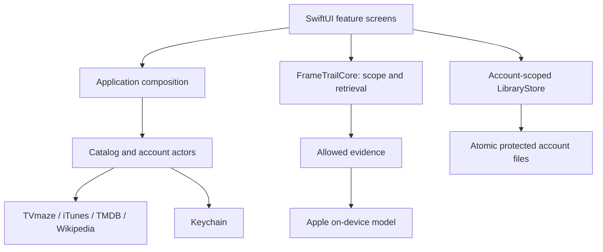

# Architecture

FrameTrail keeps story scope independent of the model. The system selects evidence before inference, and keeps account data independent of network availability.

## Boundaries

The core package accepts values and produces values. It cannot reach the network, inspect account tokens or invoke inference. Providers translate external JSON at their boundaries. A typed HTTP client enforces transport limits and cancellation. The local model receives a bounded evidence packet and cannot autonomously fetch more data.

LibraryStore commits files before publishing changed state. Each provider account has its own SHA-256-derived path. Invalid imports do not mutate state. Authentication secrets are stored by KeychainStore and never enter LibraryEntry. Signing out switches the visible namespace; guest records remain local and separate.

Views compose domain operations and display current state. They do not implement episode eligibility or deserialize provider payloads. AppModel owns the service instances and account lifecycle. Small native components keep layout consistent without introducing a separate design-system dependency.

## Quality boundaries

Deterministic filtering guarantees which evidence the application supplies. It cannot guarantee what an unconstrained generative model may recall from training. The evidence inspector is available without generation. Facts and interpretation have distinct intent, and source coverage is visible.

Movie plot retrieval is completion-gated. TV facts have explicit episode identifiers, so alternate episode numbering or a missing episode cannot accidentally become an ordinal permission. A change to watched scope invalidates the prior discussion. Pending responses must also be discarded after account/scope changes.

The installed system model is shared by the OS and is not copied into the app bundle. Network caches are ephemeral, selected text lives in the library, and the app's storage controls remove downloaded content separately from watch progress and personal records.

## Delivery

XcodeGen defines the project. The standalone core is tested before iOS simulator tests, then a device app is built without signing. Packaging validates bundle version and size, produces a standard Payload archive and checksum, and the gated tag workflow publishes an unsigned IPA for AltStore. Physical model performance and LiveContainer behavior remain separate acceptance checks.

The maintained behavior contract is [the release canvas](specs/1.0.0-beta.1.md). Changes in requirements update it before implementation; refactoring synchronizes this boundary map with the resulting code.
